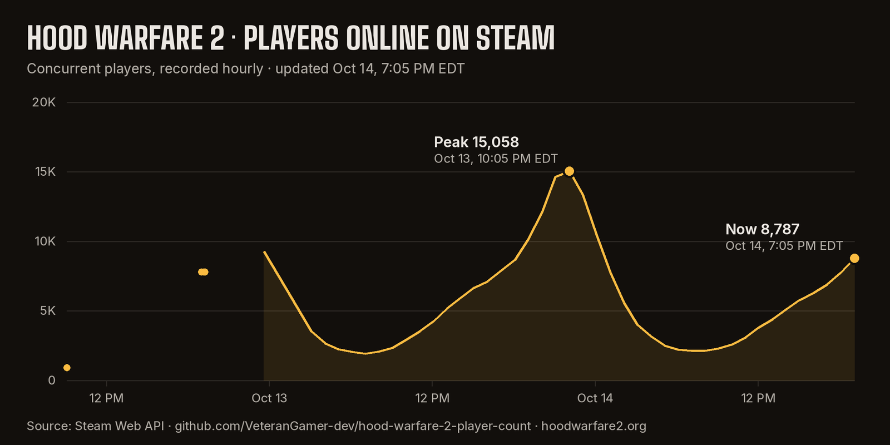

# Hood Warfare 2 player count tracker

How many people are playing [Hood Warfare 2](https://store.steampowered.com/app/5155360/Hood_Warfare_2/) on Steam, recorded every hour since October 12, 2026. The chart and the numbers below update automatically.



<!-- stats:start -->
| | Players | When (US Eastern) |
|---|---:|---|
| Latest reading | **8,787** | Oct 14, 2026, 7:05 PM EDT |
| Peak in the last 24 hours | 15,058 | Oct 13, 2026, 10:05 PM EDT |
| Highest reading recorded | 15,058 | Oct 13, 2026, 10:05 PM EDT |

47 readings since Oct 12, 2026, 9:04 AM EDT.
<!-- stats:end -->

## Before this tracker started

Hood Warfare 2 launched on Steam on October 8, 2026. This tracker only contains readings it took itself, starting October 12. For the earlier days, [SteamDB](https://steamdb.info/app/5155360/charts/) recorded a peak of about 4,500 concurrent players on October 12, 2026 (UTC), and players kept climbing after that, with 7,808 online on the evening of October 12 (US Eastern). SteamDB recorded a peak of 11,742 on the night of October 12 (US time), between two of our hourly readings. The game kept growing: on the evening of October 13 (US time) this tracker recorded 15,058, a new all-time high. See SteamDB for the full history since launch.

## What the number means

This is the number Steam reports as "in game" right now. It counts everyone who has Hood Warfare 2 open, including people sitting in menus and people playing bot matches. That's why the in-game lobby list can look much emptier than this number: it only shows public lobbies you can join at that moment.

For the number right now, an interactive chart and the busiest hours in your own time zone, see the **[live Hood Warfare 2 player count](https://hoodwarfare2.org/player-count/)**. For what players think of the game and why the in-game lobby list looks emptier than Steam's number, see the [Hood Warfare 2 review](https://hoodwarfare2.org/review/#player-count-fake) on the same unofficial fan guide.

## The data

[`data/players.csv`](data/players.csv) has one row per reading:

| Column | Meaning |
|---|---|
| `timestamp_utc` | When the reading was taken, in UTC |
| `players` | Concurrent players on Steam at that moment |
| `source` | `steam_api` for automatic hourly readings, `manual` for the two readings taken before the tracker started |

- **Source:** the Steam Web API (`ISteamUserStats/GetNumberOfCurrentPlayers`, app ID 5155360).
- **How often:** a Cloudflare Worker takes a reading every hour at :05 UTC. GitHub's own scheduled runs turned out to be late or skipped too often, so this repo no longer depends on them for the data: a [GitHub Actions workflow](.github/workflows/record.yml) copies everything the Worker has into this CSV and redraws the chart whenever it runs. Readings more than 3 hours apart aren't joined on the chart.
- **Live copy:** the Worker serves the same data, always up to date, at [data.hoodwarfare2.org/hw2/players.csv](https://data.hoodwarfare2.org/hw2/players.csv) (also [.json](https://data.hoodwarfare2.org/hw2/players.json) and a live [chart](https://data.hoodwarfare2.org/hw2/chart.svg)).
- **Times on the chart** are US Eastern.

## Use it

The data is free to use under [CC BY 4.0](https://creativecommons.org/licenses/by/4.0/). Please credit "Hood Warfare 2 player count tracker" with a link to this repository. The code is MIT-licensed (see [LICENSE](LICENSE)).

Run it yourself:

```
pip install pillow
python scripts/record.py            # take a reading, redraw the chart
python scripts/record.py --render   # redraw from the CSV only
```

Fonts: [Big Shoulders](https://github.com/xotypeco/big_shoulders) and [Inter](https://github.com/rsms/inter), both under the SIL Open Font License (see `fonts/`).

---

Not affiliated with Trapstar Games or Valve.
